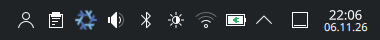
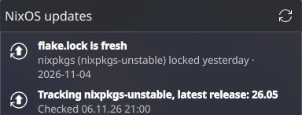
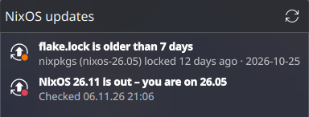
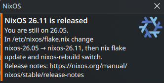

# nixos-update-check

[](https://github.com/samularity/nixos-versioncheck/actions/workflows/check.yml)
[](https://github.com/samularity/nixos-versioncheck/actions/workflows/update-flake-lock.yml)

Never miss a NixOS upgrade again. Two reminders for a flake-based NixOS on KDE Plasma:

- **A notification when a new NixOS release is out** (e.g. 26.11), once a day until you upgrade.
- **A tray icon next to Wi-Fi and battery** that turns orange when your `flake.lock` is older than a week.



## What it looks like

### Tray widget

Click the snowflake to see the details:

| Everything up to date | Lock stale, new release available |
| --- | --- |
|  |  |

The icon gets a badge when something needs your attention:

- **Orange:** the `nixpkgs` input in `flake.lock` is 7 days old or older.
- **Red:** a new NixOS release is available, or the check failed.

The popup also tells you when the lock changed but you haven't rebuilt yet, and
shows the command to fix things. The refresh button checks for a new release
immediately.

### Release notification



- **On a stable branch** (`nixos-26.05`): you get this notification once a day
  until you switch to the new release.
- **On `nixpkgs-unstable`**: there is nothing to upgrade to, so you get a single
  notification per release, as a hint in case you want to go back to stable.

A release only counts once it's really out, not when its branch is created a few
weeks earlier. The `channels.nixos.org/nixos-YY.MM` channel must point to a
final, non-beta build.

## Installation

Add the flake to your system configuration:

```nix
# flake.nix
inputs.nixos-update-check.url = "github:samularity/nixos-versioncheck";
inputs.nixos-update-check.inputs.nixpkgs.follows = "nixpkgs";

outputs = { self, nixpkgs, nixos-update-check, ... }:
# ...
modules = [
  nixos-update-check.nixosModules.default
  { services.nixos-update-check.enable = true; }
];
```

Then rebuild. The widget appears in the system tray automatically. If it
doesn't, log out and back in once, or right-click the tray arrow →
*Configure System Tray* → *Entries* → "NixOS Update Status" → *Always shown*.

### Options

All options live under `services.nixos-update-check`:

| Option | Default | Description |
| --- | --- | --- |
| `enable` | `false` | Enable the timer, the CLI and the widget. |
| `flakePath` | `"/etc/nixos"` | Directory containing your system `flake.lock`. |
| `input` | `"nixpkgs"` | Flake input whose age and branch are checked. |
| `maxAgeDays` | `7` | Days after which the lock counts as stale. |
| `plasmoid.enable` | `true` | Install the Plasma tray widget. |

The lock age is the commit date of the locked nixpkgs revision, i.e. how old the
packages you build actually are, not when you last ran `nix flake update`.

## How it works

- A systemd user timer runs `nixos-update-check release --notify` hourly and
  shortly after login. The network is queried at most every 12 hours, and you
  get at most one notification per day.
- The widget runs `nixos-update-check status` every 15 minutes. That command
  works offline: it reads `flake.lock` and the cached result of the last
  release check.
- State is kept in `~/.local/state/nixos-update-check/`.

## Command line

```sh
nixos-update-check status              # JSON status, as used by the widget
nixos-update-check release --force     # check for a new release now
nixos-update-check test-notify         # send a test notification
systemctl --user list-timers nixos-update-check
journalctl --user -u nixos-update-check
```

## Development

```sh
nix build .#nixos-update-check   # the script
nix build .#plasmoid             # the Plasma widget
nix flake check                  # build both, shellcheck, evaluate the module
```

Two GitHub Actions keep the repo healthy:

- **check** runs `nix flake check` on every push and pull request.
- **update flake.lock** runs every Monday: it updates `flake.lock`, runs all
  checks, and pushes only if they pass. If they fail, nothing changes and GitHub
  emails the repo owner.
